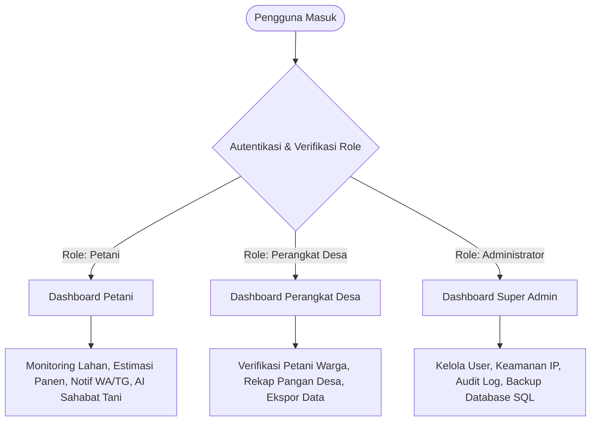

# 🌾 Platform Padi Desa (AgriPlatform v2.0)
> **Sistem Informasi Manajemen, Monitoring Siklus Pertanian Padi, dan Otomasi Notifikasi Cerdas Berbasis Desa**

[](https://www.php.net/)
[](https://www.mysql.com/)
[](https://laragon.org/)
[](https://ai.google.dev/)
[](https://fonnte.com/)
[](https://docs.python.org/3/library/unittest.html)

---

## 📌 1. Deskripsi Proyek
**Platform Padi Desa** adalah platform digital berbasis web yang dirancang khusus untuk mendigitalisasi sektor pertanian padi di tingkat pedesaan. Sistem ini menjembatani komunikasi data antara **Petani**, **Aparatur Pemerintah Desa**, dan **Administrator Sistem** guna meningkatkan produktivitas panen, memantau sebaran petak sawah, serta memberikan edukasi dan pendampingan budidaya padi secara real-time.

Platform ini mengintegrasikan **AI Chatbot (Google Gemini)** untuk konsultasi hama padi dan **Otomasi Notifikasi Multi-Channel** (Web, WhatsApp Fonnte API, Bot Telegram, dan Email SMTP) yang otomatis berbunyi pada setiap milidetik siklus penting tanaman padi petani.

---

## 👥 2. Hak Akses & Peran Pengguna (Role Architecture)

Sistem ini menerapkan **Role-Based Access Control (RBAC)** yang ketat dan terbagi menjadi 3 level pengguna:



### 1. Petani (End-User Sawah)
* **Pusat Monitoring Lahan**: Pencatatan data petak sawah (luas $\text{m}^2$, varietas padi, tanggal tanam, dan kalkulasi otomatis perkiraan waktu panen 120 hari).
* **Otomasi Pengingat Siklus Padi**: Menerima pesan otomatis langsung ke nomor WhatsApp dan Telegram saat masuk fase air macak-macak, sulam gulma, pemupukan pertama & kedua, serta H-7 panen.
* **Sahabat Tani AI**: Konsultasi keluhan hama, penyakit wereng/kresek, takaran pupuk NPK/Urea langsung dengan AI cerdas berbasis konteks pertanian padi.
* **Pengaturan Kontak Notifikasi**: Mengelola nomor WhatsApp aktif dan sinkronisasi Telegram Chat ID pribadi.

### 2. Perangkat Desa (Pemerintah Desa)
* **Verifikasi Akun Petani**: Meninjau dan menyetujui pendaftaran petani baru sebelum mereka dapat menggunakan platform.
* **Rekapitulasi Produksi Wilayah**: Memantau total luas sawah produktif desa, sebaran varietas unggul, dan prediksi agregat tonase panen pangan desa.
* **Ekspor Laporan Resmi**: Mengunduh arsip rekapitulasi desa dalam format siap cetak (Excel/CSV/PDF).
* **Profil Wilayah Desa**: Pengaturan parameter desa dan target hasil produktivitas per $\text{m}^2$.

### 3. Administrator (Super Admin / Security)
* **Manajemen Pengguna**: Aktivasi, perubahan role, dan pemblokiran akun bermasalah.
* **Sistem Keamanan & Firewall**: Deteksi serangan Brute Force, perlindungan CSRF Token ganda, pemblokiran otomatis IP berbahaya, dan audit jejak aktivitas (`log_aktivitas`).
* **Backup Database**: Pembuatan dan pengunduhan file dump cadangan database (`.sql`) secara berkala dengan satu klik.

---

## ⚡ 3. Fitur Unggulan Sistem

| Fitur | Deskripsi Teknologi | Manfaat bagi Petani / Desa |
|---|---|---|
| **Notifikasi WhatsApp Real-time** | Fonnte REST API via cURL PHP | Petani menerima jadwal pemupukan langsung di aplikasi chat WhatsApp tanpa harus membuka website setiap hari. |
| **Integrasi Bot Telegram** | Telegram Bot API (`@PlaformPadiDesa_bot`) | Jalur alternatif pengiriman pengingat jadwal panen secara gratis dan instan. |
| **Email SMTP Notifikasi** | PHPMailer + Gmail SMTP TLS | Notifikasi email resmi untuk OTP verifikasi pendaftaran akun dan peringatan panen. |
| **AI Smart Consultation** | Google Gemini Generative AI (Vision & Text) | Memberikan diagnosa cepat penyakit tanaman padi dan panduan dosis pemupukan berimbang. |
| **Sinkronisasi Siklus Cerdas** | Algoritma `sync_notifikasi_petani()` | Otomatis menghitung umur tanaman setiap kali petani berinteraksi dengan platform tanpa ketergantungan mutlak pada cron server luar. |

---

## 🧪 4. Rekayasa Perangkat Lunak: Siklus TDD & Pengujian Black-Box

Sesuai kaidah kurikulum **Outcome-Based Education (OBE) Rekayasa Perangkat Lunak**, modul perhitungan agrikultur sistem dibangun menggunakan pendekatan **Test-Driven Development (TDD)** dengan metode **Black-Box Testing (Equivalence Partitioning & Boundary Value Analysis)**.

### A. Rumus Logika Bisnis yang Diuji:
1. **Estimasi Hasil Panen**:
   $$\text{Estimasi Panen (Ton)} = \text{Luas Lahan (m}^2) \times \text{Koefisien Varietas}$$
   * `Ciherang`: $0.0055\text{ ton/m}^2$ ($5.5\text{ kg/m}^2$)
   * `Inpari`: $0.0060\text{ ton/m}^2$ ($6.0\text{ kg/m}^2$)
   * `Mekongga`: $0.0050\text{ ton/m}^2$ ($5.0\text{ kg/m}^2$)
   * `Sintanur`: $0.0045\text{ ton/m}^2$ ($4.5\text{ kg/m}^2$)

2. **Penentuan Fase Siklus Berdasarkan Umur Hari**:
   * **Hari 0 – 2**: Tanam Awal (Persiapan Lahan)
   * **Hari 3 – 6**: Cek Air Macak-macak (1-2 cm)
   * **Hari 7 – 13**: Adaptasi Bibit & Penyulaman Gulma
   * **Hari 14 – 44**: Waktunya Pemupukan Pertama (Fase Vegetatif)
   * **Hari 45 – 112**: Waktunya Pemupukan Kedua (Fase Generatif)
   * **Hari 113 – 119**: H-7 Menuju Hari Panen
   * **Hari $\ge$ 120**: Hari Panen Raya Tiba

3. **Validasi Batas Ekstrem (BVA) & Error Handling**:
   * $\text{Luas} \le 0 \rightarrow$ melempar `ValueError("Luas lahan harus lebih besar dari 0")`
   * $\text{Umur} < 0 \rightarrow$ melempar `ValueError("Umur padi tidak boleh negatif")`
   * Varietas tidak terdaftar $\rightarrow$ melempar `ValueError("Varietas padi tidak valid")`

### B. Siklus Pengujian Red-Green-Refactor:
```text
  [ RED ]      --> Tulis test case terlebih dahulu di 'test_kalkulator_padi.py' (Wajib GAGAL)
     │
  [ GREEN ]    --> Tulis kode fungsi 'kalkulator_padi.py' sampai seluruh unit test LOLOS (OK)
     │
  [ REFACTOR ] --> Optimasi kode, perapihan struktur if-else tanpa mengubah fungsi eksternal
```

Untuk menjalankan unit test otomatis di terminal:
```bash
python -m unittest tests/test_kalkulator_padi.py
```
*Output keberhasilan pengujian:*
```text
........
----------------------------------------------------------------------
Ran 8 tests in 0.002s

OK
```

---

## 🛠️ 5. Arsitektur Folder Proyek

```text
PLATFORM PERTANIAN PADI/
├── assets/                     # Aset gambar, ikon, dan branding
├── includes/                   # Modul backend & fungsi inti
│   ├── config.php              # Konfigurasi database, SMTP, Token Telegram & Fonnte
│   ├── functions.php           # Helper global (cURL WA, Telegram, Audit Log, CSRF)
│   ├── validasi.php            # Validasi form input (BVA: No HP, Luas, Nama)
│   ├── email_helper.php        # Integrasi PHPMailer pengiriman OTP & notifikasi
│   ├── gemini_function.php     # Engine AI Chatbot Google Gemini
│   ├── navbar.php              # Header, sidebar dinamis per role, dan lonceng notif
│   └── footer.php              # Footer modern platform
├── pages/                      # Antarmuka fungsional sistem
│   ├── login.php               # Login terenkripsi dengan proteksi brute-force
│   ├── register.php            # Pendaftaran petani & pengiriman OTP
│   ├── dashboard_petani.php    # Dashboard utama petani (monitoring petak sawah)
│   ├── dashboard_desa.php      # Dashboard aparat desa (rekap pangan & verifikasi)
│   ├── dashboard_admin.php     # Dashboard super admin (security & kendali)
│   ├── data_lahan.php          # Manajemen data petak sawah petani
│   ├── tambah_lahan.php        # Tambah petak sawah baru & otomatis hitung panen
│   ├── setting_notifikasi.php  # Pengaturan integrasi WhatsApp & Bot Telegram
│   ├── test_wa.php             # Halaman live testing pengiriman WhatsApp API
│   ├── ai_chat.php             # Chatbot interaktif Sahabat Tani AI
│   ├── rekap_desa.php          # Rekapitulasi agregat komoditas padi desa
│   ├── backup_data.php         # Generator backup database SQL
│   └── cron_notifikasi.php     # Task cron server untuk generate notifikasi terjadwal
├── public/                     # Asset public & entry point
│   ├── css/style.css           # Styling utama modern Dash UI Suite
│   └── index.php               # Landing page informatif desa
├── tests/                      # Modul Pengujian Unit & TDD
│   ├── kalkulator_padi.py      # Kode fungsional modul perhitungan padi ter-refactor
│   └── test_kalkulator_padi.py # Skenario automated unit testing (BVA & EP)
├── README.md                   # Dokumentasi resmi proyek
└── .gitignore                  # Filter pengecualian file arsip Git
```

---

## 🚀 6. Panduan Instalasi & Menjalankan di Lokal (Localhost)

### Prasyarat Sistem:
* **Laragon** (atau XAMPP) dengan **PHP $\ge$ 8.2** dan **MySQL/MariaDB**.
* Web Browser modern (Chrome, Edge, atau Firefox).
* Koneksi internet (untuk integrasi AI Gemini, Fonnte WA, dan Bot Telegram).

### Langkah Instalasi:
1. **Clone atau Letakkan File Proyek**:
   Letakkan folder proyek di dalam root web server Laragon:
   ```text
   C:\laragon\www\PLATFORM PERTANIAN PADI\
   ```
2. **Import Database MySQL**:
   * Buka **HeidiSQL** atau **phpMyAdmin** (`http://localhost/phpmyadmin`).
   * Buat database baru bernama: `db_padi`.
   * Import file database SQL proyek Anda ke dalam `db_padi`.
3. **Konfigurasi Sistem (`includes/config.php`)**:
   Sesuaikan koneksi database dan API Token Anda:
   ```php
   $host = 'localhost';
   $user = 'root';
   $password = '';
   $database = 'db_padi';

   // Token WhatsApp Fonnte
   define('FONNTE_TOKEN', 'YOUR_FONNTE_DEVICE_TOKEN');

   // Token Bot Telegram
   define('TELEGRAM_BOT_TOKEN', 'YOUR_TELEGRAM_BOT_TOKEN');
   ```
4. **Jalankan Aplikasi**:
   * Buka browser dan akses:
     ```text
     http://localhost/PLATFORM%20PERTANIAN%20PADI/
     ```
   * Akun bawaan sistem untuk pengujian:
     * **Admin**: `admin@padidesa.com`
     * **Perangkat Desa**: Silakan login dengan akun aparat desa terdaftar.
     * **Petani**: Silakan login atau registrasi akun petani baru.

---

## 👨‍💻 7. Tim Pengembang & Identitas Akademik
* **Mata Kuliah**: Rekayasa Perangkat Lunak (TIKB2503021)
* **Program Studi**: S1 Teknik Informatika
* **Perguruan Tinggi**: STMIK IKMI Cirebon
* **Tahun Akademik**: 2026 / 2027

---

<div align="center">
  <sub>Dikembangkan dengan sepenuh hati untuk memajukan ketahanan pangan dan digitalisasi pertanian desa di Indonesia 🇮🇩🌾</sub>
</div>

